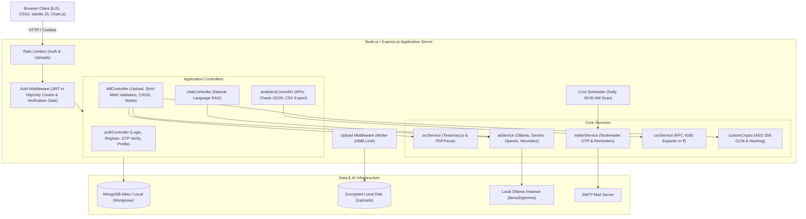
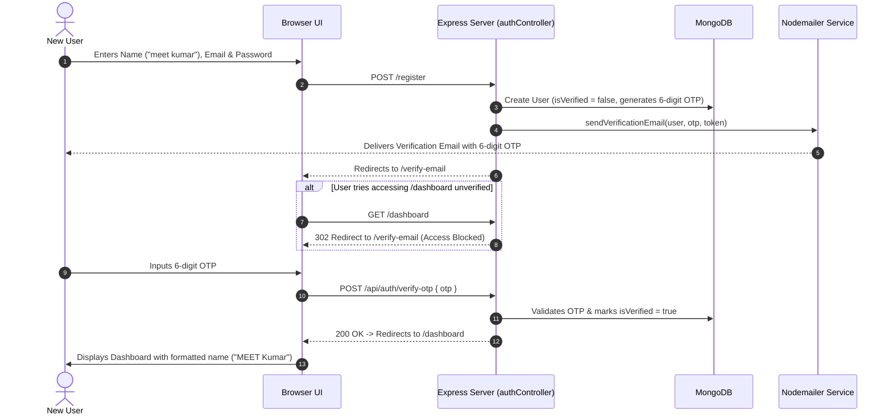
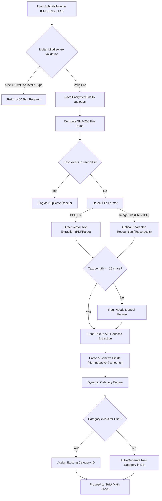
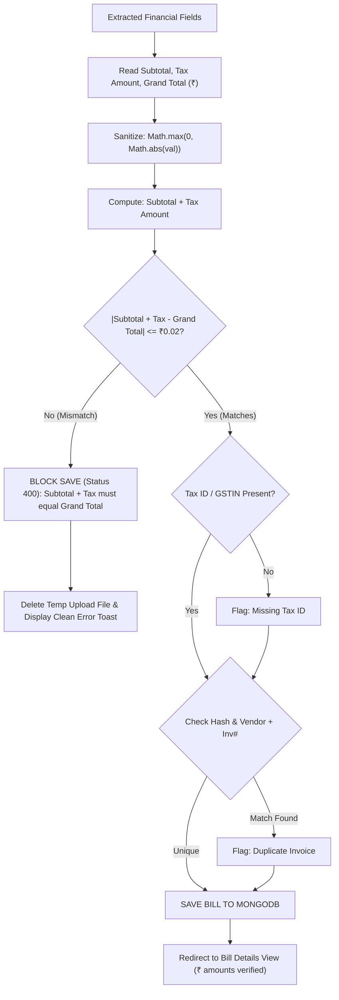
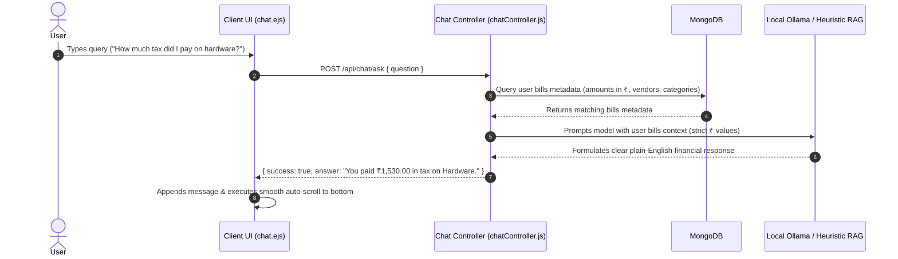

# 🧾 AI-Powered Audit & Tax Bill Management Web Application

> **Production-ready, enterprise-grade AI audit and tax invoice management portal built with Node.js, Express, EJS, Vanilla JavaScript, Chart.js, and MongoDB.**

---

## 📋 Table of Contents
1. [Overview](#-overview)
2. [Tech Stack Constraints](#-tech-stack-constraints)
3. [Core Feature Matrix](#-core-feature-matrix)
4. [Visual Workflows & Architectural Diagrams](#-visual-workflows--architectural-diagrams)
   - [1. High-Level System Architecture](#1-high-level-system-architecture)
   - [2. Email Verification & Onboarding Workflow](#2-email-verification--onboarding-workflow)
   - [3. Multi-Step Invoice Upload & AI Extraction Pipeline](#3-multi-step-invoice-upload--ai-extraction-pipeline)
   - [4. Strict Math & Audit Enforcement Flow](#4-strict-math--audit-enforcement-flow)
   - [5. "Ask Your Bills" Local RAG Chat Sequence](#5-ask-your-bills-local-rag-chat-sequence)
5. [Directory Structure](#-directory-structure)
6. [Security & Cryptography Architecture](#-security--cryptography-architecture)
7. [Step-by-Step Setup Guide](#-step-by-step-setup-guide)
8. [Configuration Reference (.env)](#-configuration-reference-env)
9. [API & Route Specifications](#-api--route-specifications)
10. [Automated Test Suite](#-automated-test-suite)
11. [License](#-license)

---

## 🌟 Overview

The **AI-Powered Audit & Tax Bill Management Web Application** is designed for accountants, corporate auditors, and finance officers. It automates receipt extraction, validates tax calculations (GST/VAT in Indian Rupees ₹), enforces strict mathematical integrity before saving bills, flags duplicate receipts and missing tax registration IDs, enables PII masking for sensitive numbers, and features a local **"Ask Your Bills"** Natural Language RAG assistant.

---

## 🛠 Tech Stack Constraints

Strictly adheres to non-SPA, server-rendered standards:
- **Backend**: Node.js (v18+), Express.js (v5)
- **Frontend / Templating**: EJS (Embedded JavaScript), Semantic HTML5, Minimalist Two-Color CSS3 (Deep Slate/Navy + Refined Blue), Vanilla JavaScript (DOM manipulation & Fetch API)
- **Data Visualization**: Chart.js (v4) with Indian Rupee formatting (`₹`)
- **Database**: MongoDB Atlas / Local MongoDB via Mongoose ODM
- **Authentication & Security**: Email Verification (6-digit OTP / secure link), JWT stored in `httpOnly`, `sameSite`, and `secure` cookies, `bcryptjs` password hashing, `express-rate-limit`
- **File Ingestion**: Multer with 10MB limits, MIME-type validation, and local encrypted paths
- **Email Dispatching**: Nodemailer with `node-cron` for automated 3-day payment reminders and signup OTPs
- **OCR Engine**: Tesseract.js optical character recognition + PDF direct text parser
- **AI Processing**: Local Ollama REST API (running open-weight models like `llama3` / `gemma`) with cloud fallback and heuristic rules
- **Currency**: Exclusively Indian Rupees (**₹**) across all dashboards, charts, CSV reports, and audit math checks

---

## 🚀 Core Feature Matrix

| Feature | Description |
| :--- | :--- |
| **🔐 Secure Auth & Email OTP** | Accounts require 6-digit OTP / link email verification via Nodemailer before dashboard access is permitted. |
| **🔤 First-Word Caps Profile** | User full name automatically formatted with CAPS LOCK ON THE FIRST WORD (e.g., `MEET Kumar`). |
| **📄 Smart Bill Upload & OCR** | Accepts PDF, PNG, JPG, and JPEG up to 10MB. Automatically extracts text using PDF vector parsing or Tesseract.js OCR. |
| **🤖 Multi-Provider AI Parsing** | Extracts Vendor Name, Firm Name, Invoice #, Bill Date, Due Date, Itemized Costs, Subtotal, Tax (GST/VAT), Grand Total, and Tax IDs. |
| **🏷️ Dynamic Category Engine** | Matches against existing user categories; automatically creates new categories for unrecognized bill types. |
| **🛑 Strict Math Rule Enforcement** | Subtotal + Tax Amount MUST equal Grand Total. Bills with calculation mismatches are blocked from database saving (HTTP 400). |
| **⚠️ Duplicate Protection** | Computes SHA-256 hash of files and cross-references Vendor Name + Invoice Number to prevent duplicate expense claims. |
| **🏛️ Tax Rule Compliance** | Validates presence of Tax Identification Numbers (GSTIN, VAT ID) required for claiming Input Tax Credits (ITC). |
| **👁️ PII Masking & Redaction** | Toggleable masking (`.pii-masked`) that blurs credit card, bank account, and tax IDs. |
| **📊 Chart.js Dashboard** | Interactive dashboard presenting Gross Spending, Claimable Tax, Due Amounts, Category Breakdown, and Monthly Trends in ₹. |
| **💬 "Ask Your Bills" RAG Chat** | Conversational assistant with smooth auto-scroll allowing users to query invoices in natural language. |
| **📥 RFC 4180 CSV Export** | Endpoints to export complete filtered bills or category-wise tax and expense summary reports in ₹. |
| **📬 3-Day Due Date Reminders** | Daily `node-cron` job automatically checks pending due dates and sends payment reminder emails via Nodemailer. |

---

## 📊 Visual Workflows & Architectural Diagrams

### 1. High-Level System Architecture



---

### 2. Email Verification & Onboarding Workflow



---

### 3. Multi-Step Invoice Upload & AI Extraction Pipeline



---

### 4. Strict Math & Audit Enforcement Flow



---

### 5. "Ask Your Bills" Local RAG Chat Sequence



---

## 📂 Directory Structure

```text
├── config/
│   ├── db.js                 # MongoDB connection with retry logic
│   └── customCrypto.js       # AES-256-GCM cipher, SHA-256 hashing, PII masking
├── controllers/
│   ├── authController.js     # Auth, signup, email OTP verification, profile settings
│   ├── billController.js     # Upload, strict math enforcement, CRUD, audit notes
│   ├── analyticsController.js# KPI computation, Chart.js feeds, RFC 4180 CSV exports
│   └── chatController.js     # "Ask Your Bills" Natural Language RAG assistant
├── middleware/
│   ├── authMiddleware.js     # Cookie JWT parser, isVerified gate, first-word caps
│   └── uploadMiddleware.js   # Multer file ingestion (10MB limit, type validation)
├── models/
│   ├── User.js               # User schema, password hashing, OTP generator, name caps
│   ├── Bill.js               # Bill document schema, audit flags, itemized line items
│   └── Category.js           # Spending categories with auto-seeding
├── services/
│   ├── ocrService.js         # Tesseract.js & PDFParse text extraction
│   ├── aiService.js          # Ollama inference & fallback heuristic parser (INR)
│   ├── mailerService.js      # Nodemailer OTP verification & 3-day due reminders
│   └── csvService.js         # RFC 4180 CSV export generator with ₹ headers
├── public/
│   ├── css/
│   │   └── style.css         # Clean two-color theme, responsive layout, badges
│   └── js/
│       ├── main.js           # Vanilla JS: dynamic navbar, upload progress, toasts
│       └── dashboardCharts.js# Chart.js visualizations formatted in Indian Rupees
├── views/
│   ├── partials/
│   │   ├── header.ejs        # HTML header, meta tags, Chart.js CDN
│   │   ├── navbar.ejs        # Responsive navbar with first-word caps display name
│   │   └── footer.ejs        # Footer and global scripts
│   ├── login.ejs             # Clean sign in card
│   ├── register.ejs          # Clean registration card (no roles)
│   ├── verify-email.ejs      # 6-digit OTP verification card with resend
│   ├── dashboard.ejs         # Financial audit KPI cards & charts in ₹
│   ├── bills.ejs             # Registry table with filters and audit checks
│   ├── billDetail.ejs        # Detail verification view (download removed from preview)
│   ├── upload.ejs            # Clean drag-and-drop file upload view
│   ├── settings.ejs          # Profile info and automated reminder preferences
│   └── chat.ejs              # "Ask Your Bills" RAG chat with smooth auto-scroll
├── test_audit_suite.js       # 29/29 automated unit and integration tests
├── app.js                    # Express application entry point & cron scheduler
├── package.json              # Dependencies and start scripts
└── README.md                 # Complete documentation and architectural diagrams
```

---

## 🔒 Security & Cryptography Architecture

- **HTTP-Only Cookies**: JWT tokens stored strictly in HTTP-Only, SameSite cookies to mitigate XSS attacks.
- **Strict Verification Gate**: Unverified users cannot access `/dashboard`, `/bills`, `/upload`, or `/chat`.
- **SHA-256 Duplicate Protection**: Invoices are cryptographically hashed upon upload to prevent double claiming.
- **Strict Mathematical Integrity**: `|Subtotal + Tax Amount - Grand Total| <= 0.02` is strictly validated. Invoices with discrepancies are blocked from database insertion.
- **PII Masking**: Toggleable client and persistent server masking blurs sensitive card numbers (`•••• •••• •••• 1234`).

---

## 🚀 Step-by-Step Setup Guide

### 1. Prerequisites
- **Node.js**: v18.0.0 or higher
- **MongoDB**: Local MongoDB instance (`mongodb://127.0.0.1:27017`) or MongoDB Atlas URI
- **Ollama (Optional for Privacy Mode)**: [Install Ollama](https://ollama.ai) and run `ollama pull llama3`

### 2. Installation
```bash
git clone https://github.com/your-org/bill-management.git
cd "bill management"
npm install
```

### 3. Environment Configuration
Create a `.env` file in the root directory:
```env
PORT=3000
NODE_ENV=development
MONGODB_URI=mongodb://127.0.0.1:27017/bill_management
JWT_SECRET=supersecret_audit_tax_jwt_dev_key_2026
ENCRYPTION_KEY=0123456789abcdef0123456789abcdef0123456789abcdef0123456789abcdef
OLLAMA_BASE_URL=http://localhost:11434
OLLAMA_MODEL=llama3
SMTP_HOST=smtp.mailtrap.io
SMTP_PORT=587
SMTP_USER=
SMTP_PASS=
SMTP_FROM="Audit & Tax Bill Manager" <alerts@taxaudit.local>
```

### 4. Running the Application
```bash
# Start in production mode
npm start

# Or development mode with auto-reload
npm run dev
```
Open **`http://localhost:3000`** in your browser.

---

## 🧪 Automated Test Suite

Run the comprehensive automated test suite:
```bash
npm test
```

### Verified Test Assertions (29/29 Passing)
- **Suite 1: Cryptography & Security**
  - `[PASS]` AES-256-GCM generates valid `IV:AuthTag:Cipher` token.
  - `[PASS]` AES-256-GCM decrypts ciphertext back to original key.
  - `[PASS]` PII masking successfully redacts 16-digit credit card sequences.
- **Suite 2: User Model, OTP & First-Word Caps**
  - `[PASS]` First word capitalized in user name: "MEET Kumar".
  - `[PASS]` Helper formats "alex morgan" to "ALEX Morgan".
  - `[PASS]` Helper formats single token names to uppercase.
  - `[PASS]` 6-digit numeric OTP generated.
  - `[PASS]` New user defaults to unverified.
  - `[PASS]` OTP expiry timestamp set in future.
  - `[PASS]` User created and saved to MongoDB without roles.
  - `[PASS]` Bcrypt password comparison succeeded.
  - `[PASS]` Default categories automatically seeded.
- **Suite 3: OCR & AI Structured Extraction (INR Currency)**
  - `[PASS]` Vendor name correctly extracted from invoice text.
  - `[PASS]` Invoice number extracted.
  - `[PASS]` Subtotal numeric value extracted.
  - `[PASS]` Tax (GST/VAT) extracted.
  - `[PASS]` Grand Total extracted.
  - `[PASS]` Tax ID / GSTIN extracted.
  - `[PASS]` Auto-classification assigns category.
- **Suite 4: Strict Math Verification & Audit Rules**
  - `[PASS]` Valid bill stored successfully.
  - `[PASS]` Strict math check passes when `Subtotal + Tax == Grand Total`.
  - `[PASS]` Strict validation detects mismatch: 5000 + 500 != 6000.
  - `[PASS]` Sanitization prevents negative currency amounts.
  - `[PASS]` Duplicate file detected via SHA-256 hash match.
- **Suite 5: "Ask Your Bills" Local RAG Querying**
  - `[PASS]` RAG query analyzes invoice context and generates response.
  - `[PASS]` Response correctly references tax amounts in ₹.
- **Suite 6: CSV Export Service (INR)**
  - `[PASS]` RFC 4180 CSV file generated with invoice headers and rows.
  - `[PASS]` Bills CSV denotes Indian Rupees (₹).
  - `[PASS]` Category breakdown CSV generated with metrics in ₹.

---

## 📄 License
This project is licensed under the ISC License.
