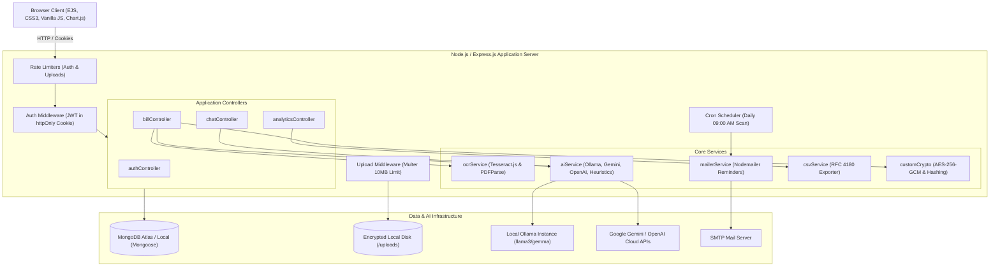
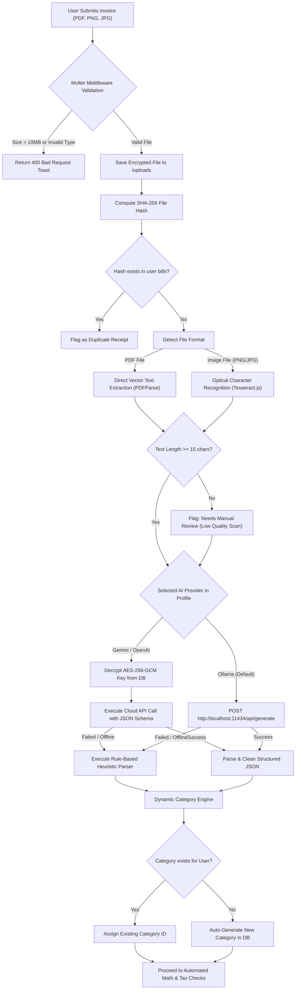
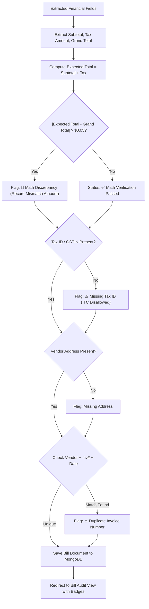
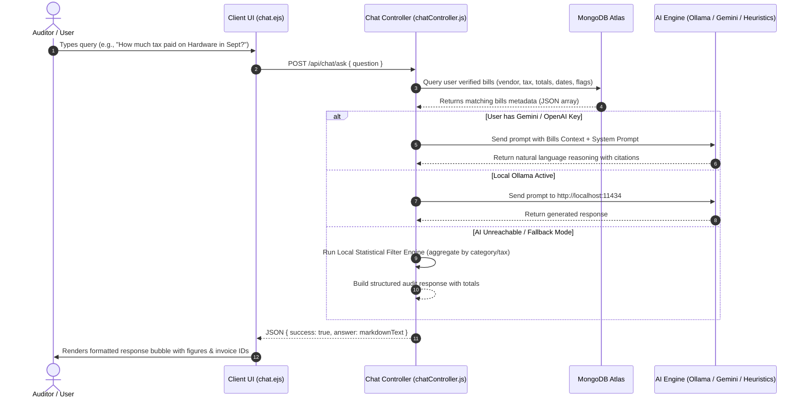

# 🧾 AI-Powered Audit & Tax Bill Management Web Application

> **Production-ready, enterprise-grade AI audit and tax invoice management portal built with Node.js, Express, EJS, Vanilla JavaScript, Chart.js, and MongoDB.**

---

## 📋 Table of Contents
1. [Overview](#-overview)
2. [Tech Stack Constraints](#-tech-stack-constraints)
3. [Core Feature Matrix](#-core-feature-matrix)
4. [Visual Workflows & Architectural Diagrams](#-visual-workflows--architectural-diagrams)
   - [1. High-Level System Architecture](#1-high-level-system-architecture)
   - [2. Multi-Step Invoice Upload & AI Extraction Pipeline](#2-multi-step-invoice-upload--ai-extraction-pipeline)
   - [3. Automated Math, Duplicate & Compliance Audit Flow](#3-automated-math-duplicate--compliance-audit-flow)
   - [4. "Ask Your Bills" Local RAG Chat Sequence](#4-ask-your-bills-local-rag-chat-sequence)
5. [Directory Structure](#-directory-structure)
6. [Security & Cryptography Architecture](#-security--cryptography-architecture)
7. [Step-by-Step Setup Guide](#-step-by-step-setup-guide)
8. [Configuration Reference (.env)](#-configuration-reference-env)
9. [API & Route Specifications](#-api--route-specifications)
10. [Automated Test Suite](#-automated-test-suite)
11. [License](#-license)

---

## 🌟 Overview

The **AI-Powered Audit & Tax Bill Management Web Application** is designed for corporate auditors, accountants, and finance compliance officers. It automates receipt extraction, validates tax calculations (GST/VAT), flags duplicate invoices and arithmetic discrepancies, enables PII masking for sensitive data protection, and features a local **"Ask Your Bills"** Natural Language RAG (Retrieval-Augmented Generation) assistant.

---

## 🛠 Tech Stack Constraints

Strictly adheres to non-SPA, server-rendered vanilla standards:
- **Backend**: Node.js (v18+), Express.js (v5)
- **Frontend / Templating**: EJS (Embedded JavaScript), Semantic HTML5, Custom CSS3 (Modern Financial Theme), Vanilla JavaScript (DOM manipulation & Fetch API)
- **Data Visualization**: Chart.js (v4)
- **Database**: MongoDB Atlas / Local MongoDB via Mongoose ODM
- **Authentication & Security**: JSON Web Tokens (JWT) stored in `httpOnly`, `sameSite`, and `secure` cookies, `bcryptjs` password hashing, `express-rate-limit`
- **File Ingestion**: Multer with 10MB limits, MIME-type validation, and local encrypted paths
- **Email Dispatching**: Nodemailer with `node-cron` for automated 3-day payment reminders
- **OCR Engine**: Tesseract.js optical character recognition + PDF direct text stream parser
- **AI Processing**:
  - **Local/Privacy Mode (Default)**: Ollama REST API running open-weight models (`llama3` / `gemma`)
  - **Cloud AI Mode**: User-supplied Google Gemini or OpenAI API keys, securely encrypted at rest using **AES-256-GCM**
  - **Fail-Safe Heuristic Engine**: Built-in rule-based regex parser that extracts invoice fields if AI services are offline

---

## 🚀 Core Feature Matrix

| Feature | Description |
| :--- | :--- |
| **🔐 Secure Authentication** | JWT authentication stored strictly in HTTP-Only cookies with brute-force rate-limiting. |
| **🛡️ AES-256 Key Vault** | User profile settings securely encrypt Gemini and OpenAI API keys via AES-256-GCM before saving to MongoDB. |
| **📄 Smart Bill Upload & OCR** | Accepts PDF, PNG, JPG, and JPEG up to 10MB. Automatically extracts text using digital PDF extraction or Tesseract.js OCR. |
| **🤖 Multi-Provider AI Parsing** | Extracts Vendor Name, Firm Name, Invoice #, Bill Date, Due Date, Itemized Costs, Subtotal, Tax (GST/VAT), Grand Total, and Tax IDs. |
| **🏷️ Dynamic Category Engine** | Matches against existing user categories; automatically creates and colors new categories for unrecognized bill types. |
| **🔴 Math Discrepancy Detection** | Automatically recalculates `Subtotal + Tax = Grand Total`. Any mismatch $> \$0.05$ is flagged as a Red Discrepancy Alert. |
| **⚠️ Duplicate Protection** | Computes SHA-256 hash of files and cross-references Vendor Name + Invoice Number to prevent duplicate expense claims. |
| **🏛️ Tax Rule Compliance** | Validates presence of Tax Identification Numbers (GSTIN, VAT ID, EIN) required for claiming Input Tax Credits (ITC). |
| **👁️ PII Masking & Redaction** | Toggleable masking (`.pii-masked`) that blurs credit card, bank account, and tax IDs before printing or downloading. |
| **📊 Chart.js Dashboard** | Interactive dashboard presenting Gross Spending, Claimable Tax, Due Amounts, Category Breakdown, and Monthly Trends. |
| **💬 "Ask Your Bills" RAG Chat** | Conversational assistant allowing auditors to query invoices in natural language using verified MongoDB metadata. |
| **📥 RFC 4180 CSV Export** | Endpoints to export complete filtered bills or category-wise tax and expense summary reports. |
| **📬 3-Day Due Date Reminders** | Daily `node-cron` job automatically checks pending due dates and sends payment reminder emails via Nodemailer. |

---

## 📊 Visual Workflows & Architectural Diagrams

### 1. High-Level System Architecture



---

### 2. Multi-Step Invoice Upload & AI Extraction Pipeline



---

### 3. Automated Math, Duplicate & Compliance Audit Flow



---

### 4. "Ask Your Bills" Local RAG Chat Sequence



---

## 📂 Directory Structure

```text
├── config/
│   ├── db.js                     # MongoDB connection with automatic retry & health-check
│   └── customCrypto.js           # AES-256-GCM encryption/decryption, PII masking, SHA-256 hash
├── controllers/
│   ├── authController.js         # Register, login, logout, profile settings & AI key updates
│   ├── billController.js         # Upload processing, registry filtering, bill edits, notes, PII
│   ├── analyticsController.js    # Aggregated KPI dashboard stats, Chart.js feeds, CSV downloads
│   └── chatController.js         # "Ask Your Bills" natural language RAG controller
├── middleware/
│   ├── authMiddleware.js         # JWT cookie validation, redirect guards, API unauthorized handler
│   └── uploadMiddleware.js       # Multer 10MB limit, disk storage, PDF/PNG/JPG MIME filter
├── models/
│   ├── User.js                   # User schema with bcrypt password hashing & encrypted AI keys
│   ├── Bill.js                   # Invoice document with items, audit flags, duplicate hash, notes
│   └── Category.js               # Category schema with auto-seed defaults per user
├── services/
│   ├── ocrService.js             # Tesseract.js image OCR + PDF vector text parser
│   ├── aiService.js              # Ollama REST + Gemini / OpenAI API + Fallback heuristic parser
│   ├── mailerService.js          # Nodemailer 3-day due date alerts and automated scanner
│   └── csvService.js             # RFC 4180 streaming CSV generator
├── public/
│   ├── css/
│   │   └── style.css             # Complete modern financial UI CSS, PII blur, print stylesheet
│   └── js/
│       ├── main.js               # Client toast alerts, upload progress, status & PII toggles
│       └── dashboardCharts.js    # Chart.js monthly trend & category doughnut charts
├── views/
│   ├── partials/
│   │   ├── header.ejs            # Head meta tags, CSS link, Chart.js script tag
│   │   ├── navbar.ejs            # Sticky header with navigation links and user badge
│   │   └── footer.ejs            # Footer branding and main.js script tag
│   ├── login.ejs                 # Auditor portal sign-in view
│   ├── register.ejs              # New user registration view
│   ├── dashboard.ejs             # Executive financial dashboard with KPI cards and charts
│   ├── bills.ejs                 # Searchable, filterable bills registry table with pagination
│   ├── billDetail.ejs            # Detailed bill audit view with inline editing and notes
│   ├── upload.ejs                # Multi-step drag-and-drop bill upload view with progress bar
│   ├── settings.ejs              # AI provider configuration and AES-256 key management
│   └── chat.ejs                  # "Ask Your Bills" natural language conversational RAG view
├── .env.example                  # Environment configuration template
├── .env                          # Local active environment configuration
├── app.js                        # Main Express server, middleware, routes, and cron schedule
├── test_audit_suite.js           # Automated end-to-end audit test suite (22 tests)
└── package.json                  # Dependencies, scripts, and project metadata
```

---

## 🔒 Security & Cryptography Architecture

### 1. AES-256-GCM API Key Storage
User-provided cloud API keys (Google Gemini or OpenAI) are **never** stored in plain text.
- Keys are encrypted using **AES-256-GCM** with a cryptographically random 16-byte initialization vector (IV) per entry.
- The authentication tag ensures ciphertext integrity and prevents tampering.
- Format stored in MongoDB: `iv_hex:authTag_hex:encryptedData_hex`.

### 2. JWT in HTTP-Only Cookies
- Authentication tokens are signed with a 7-day expiration.
- Stored exclusively in `httpOnly: true` cookies to defend against Cross-Site Scripting (XSS).
- Includes `sameSite: 'lax'` to protect against Cross-Site Request Forgery (CSRF).

### 3. PII (Personally Identifiable Information) Redaction
- **Visual & Print Masking**: The `.pii-masked` CSS filter blurs 16-digit credit card numbers, bank account numbers, and tax identification numbers in the browser and in `@media print`.
- **Regex Redaction Helper**: `customCrypto.maskPII()` replaces 9–18 digit sequences with `•••• •••• •••• 1234` format.

### 4. Rate Limiting
- `express-rate-limit` is configured on sensitive routes:
  - Auth routes (`/login`, `/register`): **30 requests per 15 minutes**.
  - Upload routes (`/api/bills/upload`): **60 uploads per 15 minutes**.

---

## 💻 Step-by-Step Setup Guide

### Prerequisites
- [Node.js](https://nodejs.org/) v18.0.0 or higher
- [MongoDB](https://www.mongodb.com/) (Local service or MongoDB Atlas connection URI)
- Optional: [Ollama](https://ollama.ai/) installed locally if running open-weight local models (`llama3`, `gemma`)

### 1. Clone & Navigate to Project
```bash
git clone <repository-url>
cd "bill management"
```

### 2. Install Dependencies
```bash
npm install
```

### 3. Configure Environment Variables
Copy `.env.example` to `.env`:
```bash
# On Windows PowerShell:
Copy-Item .env.example .env

# On Linux / macOS:
cp .env.example .env
```
Ensure your MongoDB instance is running, or update `MONGODB_URI` with your MongoDB Atlas connection string.

### 4. Run the Automated Test Suite
Verify that all 22 core cryptographic, AI extraction, math audit, and CSV export modules pass:
```bash
npm test
```

### 5. Start the Application
```bash
npm start
```
The server will boot and display:
```text
=======================================================
🚀 Audit & Tax Bill Management Web App is Running
📡 URL: http://localhost:3000
🔒 Encryption: AES-256-GCM Active
🤖 AI Pipeline: Local Ollama + Cloud Gemini/OpenAI Fallback
=======================================================
```
Open **`http://localhost:3000`** in your browser.

---

## ⚙️ Configuration Reference (.env)

| Variable | Default Value | Description |
| :--- | :--- | :--- |
| `PORT` | `3000` | Port on which the Express server listens. |
| `NODE_ENV` | `development` | Environment mode (`development` or `production`). |
| `MONGODB_URI` | `mongodb://127.0.0.1:27017/bill_management` | MongoDB Atlas or local MongoDB connection URI. |
| `JWT_SECRET` | *(string)* | Secret key used for signing and verifying JSON Web Tokens. |
| `ENCRYPTION_KEY` | *(32-byte string)* | Master key used to derive AES-256-GCM cipher for user API keys. |
| `OLLAMA_BASE_URL` | `http://localhost:11434` | REST endpoint for local Ollama daemon. |
| `OLLAMA_MODEL` | `llama3` | Default open-weight model name for Ollama inference. |
| `SMTP_HOST` | `smtp.mailtrap.io` | SMTP server host for payment reminder emails. |
| `SMTP_PORT` | `587` | SMTP port (587 for TLS, 465 for SSL). |
| `SMTP_USER` | *(empty)* | SMTP username credentials. |
| `SMTP_PASS` | *(empty)* | SMTP password credentials. |
| `SMTP_FROM` | `"Audit & Tax Bill Manager" <alerts@...>` | Outgoing sender email header. |

> *Note: If SMTP credentials are left blank, Nodemailer operates in safe development mode, logging mock reminder emails to the server console.*

---

## 📡 API & Route Specifications

### Web Views (EJS Front-End)
| Method | Route | Access | Description |
| :--- | :--- | :--- | :--- |
| `GET` | `/` | Public | Redirects to `/dashboard` if authenticated, else `/login`. |
| `GET` | `/login` | Public | Renders the Auditor Login page. |
| `GET` | `/register` | Public | Renders the Account Registration page. |
| `GET` | `/logout` | Public | Clears the `token` cookie and redirects to `/login`. |
| `GET` | `/dashboard` | Protected | Displays KPI metrics cards, Chart.js analytics, and recent bills. |
| `GET` | `/bills` | Protected | Searchable registry with filters (category, date, math errors). |
| `GET` | `/bills/:id` | Protected | In-depth audit review, manual correction form, and notes thread. |
| `GET` | `/upload` | Protected | Drag-and-drop bill upload view with multi-step progress bar. |
| `GET` | `/settings` | Protected | Profile management, AI mode selector, and AES-256 key configuration. |
| `GET` | `/chat` | Protected | "Ask Your Bills" conversational local RAG chat interface. |

### REST API Endpoints
| Method | Route | Access | Description |
| :--- | :--- | :--- | :--- |
| `POST` | `/login` | Public | Validates credentials, signs JWT, and sets `token` cookie. |
| `POST` | `/register` | Public | Creates auditor account and auto-seeds 8 default categories. |
| `POST` | `/api/bills/upload` | Protected | Multer file ingestion, OCR, AI extraction, and math audit checks. |
| `POST` | `/api/bills/:id` | Protected | Updates bill details and recalculates math discrepancy checks. |
| `DELETE`| `/api/bills/:id` | Protected | Deletes bill document and associated physical file from disk. |
| `PATCH` | `/api/bills/:id/toggle-status` | Protected | Toggles invoice status between `Paid` and `Due`. |
| `PATCH` | `/api/bills/:id/toggle-pii` | Protected | Toggles persistent PII masking on the bill. |
| `POST` | `/api/bills/:id/notes` | Protected | Appends an internal auditor observation note to the bill. |
| `GET` | `/api/analytics/data` | Protected | Returns JSON feeds for Chart.js trend and doughnut charts. |
| `GET` | `/api/analytics/export-csv` | Protected | Streams RFC 4180 CSV export (`?type=bills` or `?type=categories`). |
| `POST` | `/api/chat/ask` | Protected | Executes natural language RAG query against user's bills metadata. |
| `POST` | `/api/settings/ai` | Protected | Updates AI preferences and saves AES-256 encrypted API keys. |
| `POST` | `/api/settings/test-ai` | Protected | Live connectivity and latency test for Ollama, Gemini, or OpenAI. |

---

## 🧪 Automated Test Suite

An automated test suite is provided in [`test_audit_suite.js`](file:///d:/bill%20management/test_audit_suite.js).

Execute the test suite at any time via:
```bash
npm test
```

### Verified Test Assertions (22/22 Passing)
- **Suite 1: Cryptography & Security**
  - `[PASS]` AES-256-GCM generates valid `IV:AuthTag:Cipher` token.
  - `[PASS]` AES-256-GCM decrypts ciphertext back to original key.
  - `[PASS]` PII masking successfully redacts 16-digit credit card sequences.
- **Suite 2: User Model & Category Seeding**
  - `[PASS]` User created and saved to MongoDB.
  - `[PASS]` Bcrypt password hashing and verification succeeds.
  - `[PASS]` 8 default business categories automatically seeded on registration.
- **Suite 3: OCR & AI Structured Extraction**
  - `[PASS]` Vendor name correctly identified from invoice text.
  - `[PASS]` Invoice number identified.
  - `[PASS]` Subtotal numeric value extracted.
  - `[PASS]` Tax (GST/VAT) percentage and amount extracted.
  - `[PASS]` Grand Total extracted.
  - `[PASS]` Tax ID / GSTIN extracted.
  - `[PASS]` Auto-classification assigns category.
- **Suite 4: Automated Audit & Math Checks**
  - `[PASS]` Verified bill saves cleanly with zero discrepancy flags.
  - `[PASS]` Math discrepancy detected when `Subtotal + Tax != Grand Total`.
  - `[PASS]` Math discrepancy flag and details persisted to MongoDB.
  - `[PASS]` Missing Tax ID flagged for tax compliance.
  - `[PASS]` Duplicate receipt detected via SHA-256 file hash match.
- **Suite 5: "Ask Your Bills" Local RAG Querying**
  - `[PASS]` RAG query analyzes invoice context and generates response.
  - `[PASS]` Response correctly cites exact dollar amounts and invoice numbers.
- **Suite 6: CSV Export Generation**
  - `[PASS]` RFC 4180 CSV file generated with invoice headers and rows.
  - `[PASS]` Category breakdown CSV generated with subtotal, tax, and total sums.

---

## 📄 License
This project is licensed under the ISC License. Built for enterprise audit and tax compliance management.

